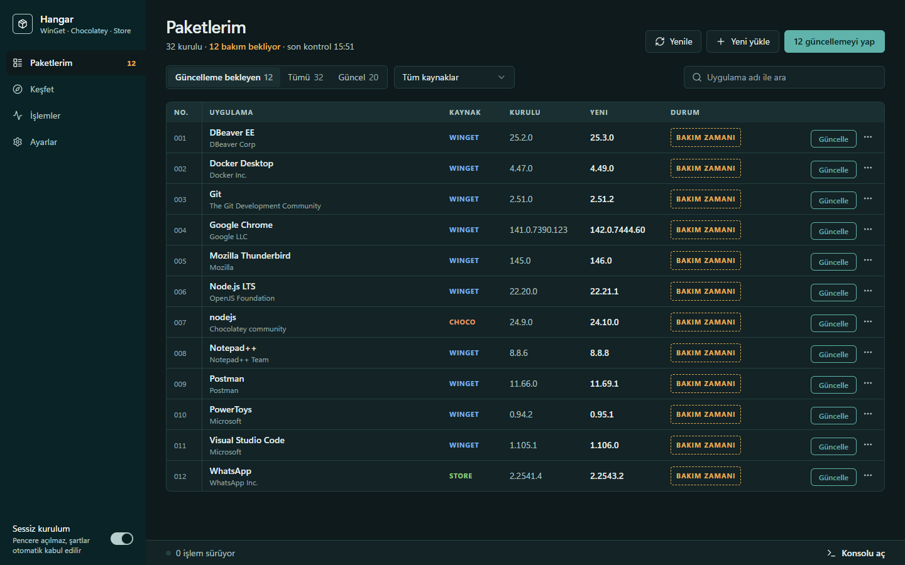
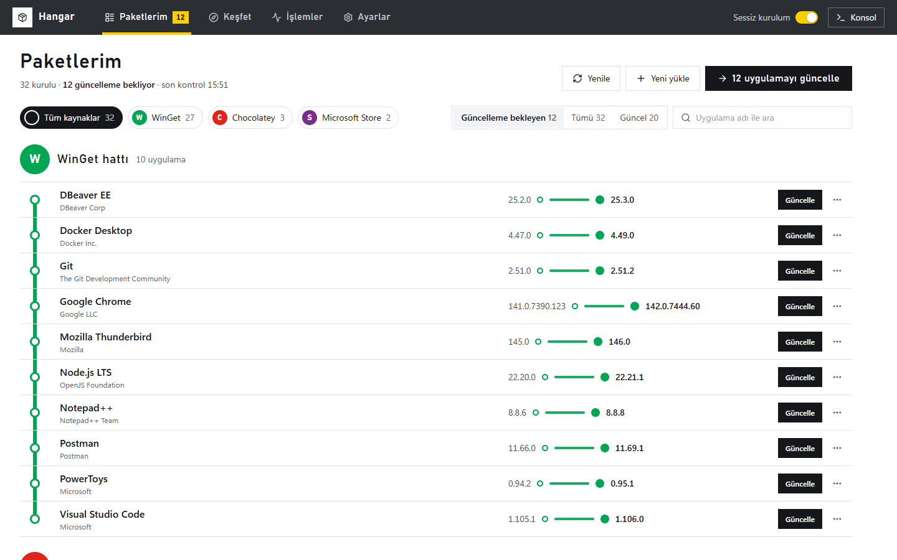
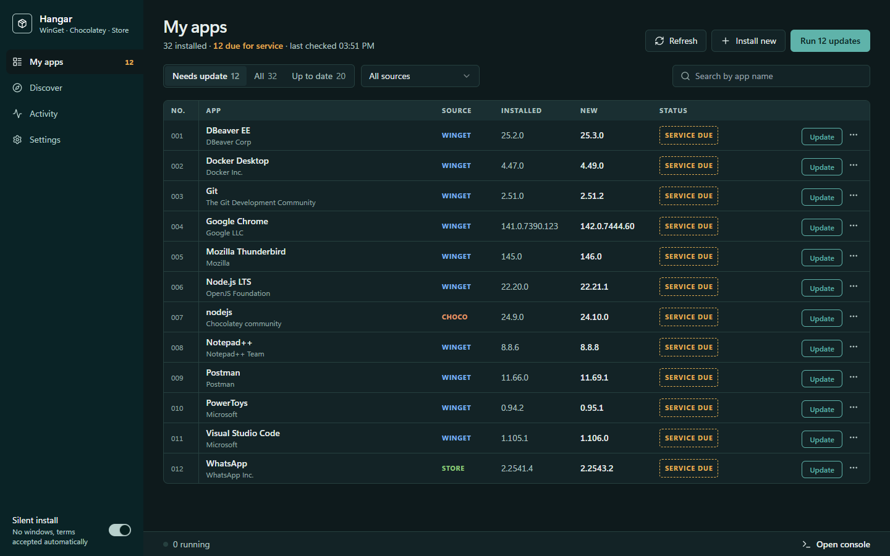
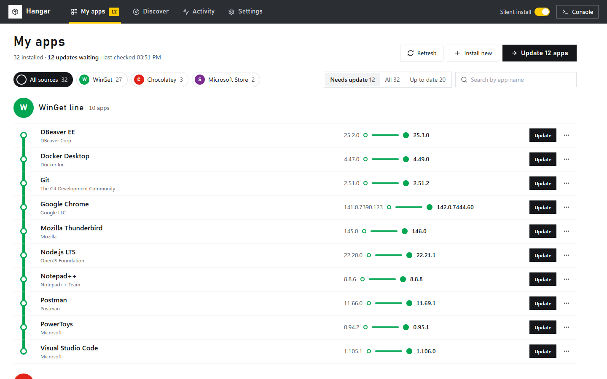

# 📦 Hangar

**[Türkçe](#-türkçe) · [English](#-english)**



---

## 🇹🇷 Türkçe

Hangar, Windows'taki uygulamalarının bakımını tek yerden yapmanı sağlayan bir masaüstü uygulaması. **WinGet**, **Chocolatey**, **Microsoft Store** ve **Scoop** paketlerini tek listede gösterir; terminal bilmeden güncellersin, kurarsın, kaldırırsın.

Açtığında ilk sorduğu soru şu: *Hangi uygulamanın bakımı gelmiş?*

### ✨ Özellikler

- **Önce güncellemeler:** Paketlerim ekranı güncelleme bekleyen uygulamaları öne alır. Tek tek ya da tek tıkla hepsini güncelleyebilirsin.
- **Gerçek ilerleme:** WinGet işlemleri resmi COM API üzerinden yapılır. İndirme ve kurulum yüzdesi winget'ten gelir; metin ayrıştırma olmadığı için Windows dilinden etkilenmez.
- **Sessiz kurulum (varsayılan):** Kurulum pencereleri açılmaz, lisans şartları otomatik kabul edilir; toplu güncellemeler takılmaz.
- **Atla veya sabitle:** İstemediğin bir sürümü atla ya da bir uygulamanın güncellemesini tamamen durdur. Toplu güncelleme bunlara dokunmaz.
- **Diğer uygulamalar:** Hiçbir paket kaynağında olmayan kurulu uygulamalar ayrı sekmede listelenir ve oradan kaldırılabilir.
- **Uygulama listesi:** Kurulu uygulamalarını bir dosyaya kaydet, yeni bilgisayarda tek seferde kur. Dosya `winget import` ile de açılır, `winget export` dosyaları da Hangar'a yüklenebilir.
- **Scoop desteği:** Scoop kuruluysa uygulamaları listelenir, güncellenir ve aranır; yönetici izni gerekmez.
- **Chocolatey desteği:** Yönetici izni gereken choco işlemleri Windows'un UAC onayıyla çalışır. Toplu güncellemede tüm choco paketleri tek onayla güncellenir.
- **Keşfet:** WinGet, Chocolatey ve Microsoft Store'da arama; tek tıkla kurulum.
- **Paket detayı:** Açıklama, yayıncı, sürüm listesi; istediğin sürüme geçebilirsin.
- **İşlemler:** Devam eden, biten ve başarısız işlemler. Hata ayrıntısı ve "Tekrar dene" aynı satırda.
- **İki düzen, sınırsız tema:**
  - **Bakım Defteri:** Sol menü, kayıt tablosu, güncellenen uygulamaya basılan servis kaşesi.
  - **Metro Yönlendirme:** Üst tabela bandı, kaynak başına hat, sürümler arası yolculuk.
  - Tema editörüyle renkleri, köşeleri, yazı boyutunu ve satır yoğunluğunu değiştir. Temaları JSON olarak dışa/içe aktar.
- **Açık / koyu / sistem** modu, **Türkçe ve İngilizce** arayüz.



### 📥 Kurulum

1. [Releases](https://github.com/hangar-win/hangar-win/releases) sayfasından son sürümün **MSI** ya da **EXE** kurulum dosyasını indir.
2. Kur ve aç.

**Gereksinimler:**
- Windows 10 (1809 ve sonrası) ya da Windows 11
- **App Installer** (winget). Windows 11'de hazır gelir, Windows 10'da Microsoft Store'dan kurulabilir.
- **Chocolatey** ve **Scoop** isteğe bağlıdır. Kurulu değillerse paketleri listelenmez.

### 💡 Kullanım notları

- **Yönetici izni:** Hangar normal kullanıcı olarak çalışır. `C:\Program Files` altına kurulan uygulamalar ve choco işlemleri sırasında Windows UAC onayı isteyebilir; bu pencere Windows'undur, onaylamadan işlem ilerlemez.
- **Ayar soran kurulumlar:** Bir kurulumda seçenekleri kendin belirlemek istiyorsan **Sessiz kurulum**'u kapat. Anahtar her ekranda görünür.
- **Kendini güncelleyen uygulamalar:** Chrome veya Discord gibi uygulamalar winget dışından güncellenirse, winget'in kaydındaki sürüm geride kalabilir. Hangar winget'in gördüğünü gösterir.

### 🛠️ Geliştirme

**Gereksinimler:** Node.js 18+, [pnpm](https://pnpm.io), [rustup](https://rustup.rs) ile Rust 1.95+.

```bash
git clone https://github.com/hangar-win/hangar-win.git
cd hangar-win
pnpm install

pnpm tauri dev      # Uygulamayı geliştirme modunda açar
pnpm dev            # Sadece tarayıcıda açar; örnek paket verisiyle çalışır
pnpm check          # TypeScript / Vue tip kontrolü
pnpm tauri build    # MSI ve EXE kurulum dosyalarını üretir
```

Rust testleri `src-tauri` klasöründe çalışır:

```bash
cargo test                    # Birim testleri
cargo test -- --ignored       # Gerçek winget'e karşı canlı test
```

**Mimari:**

| Katman | Konum | Görev |
|---|---|---|
| Arayüz | `src/templates/ledger`, `src/templates/metro` | Her düzenin kendi ekranları |
| Ortak mantık | `src/stores`, `src/composables`, `src/services` | Paket durumu, işlemler, choco komutları |
| Tema | `src/themes/tokens.ts`, `src/stores/theme.ts` | Renk token'ları, tema editörü, JSON içe/dışa aktarım |
| WinGet | `src-tauri/src/winget` | WinGet COM API: listeleme, arama, kurulum, ilerleme |
| Yetki | `src-tauri/src/elevate.rs` | Yönetici kontrolü, choco'yu UAC ile çalıştırma |
| Scoop | `src-tauri/src/scoop.rs` | Scoop'u PowerShell üzerinden çalıştırma, JSON çıktı |

`src-tauri/src/bindings.rs` dosyası, `src-tauri/winmd/Microsoft.Management.Deployment.winmd` tanım dosyasından [windows-bindgen](https://crates.io/crates/windows-bindgen) ile üretilir; elle düzenlenmez. Yeniden üretmek için:

```rust
windows_bindgen::bindgen([
    "--in", "default", "src-tauri/winmd/Microsoft.Management.Deployment.winmd",
    "--out", "src-tauri/src/bindings.rs",
    "--flat",
    "--filter", "Microsoft.Management.Deployment", "Windows.System.ProcessorArchitecture",
    "CoCreateInstance", "CoInitializeEx", "ShellExecuteExW", "SHELLEXECUTEINFOW",
    "WaitForSingleObject", "GetExitCodeProcess", "CloseHandle", "IsUserAnAdmin",
]);
```

### 🚀 Release

`release` dalına her push'ta GitHub Actions MSI ve EXE dosyalarını derler, `v<sürüm>` etiketini oluşturur ve Releases sayfasına yükler. Sürüm notları commit'lerden otomatik çıkarılır.

1. `package.json` → `"version"` değerini artır (uygulama sürümü buradan okunur) ve `main`'e gönder.
2. `main`'i `release`'e aktar:
   ```bash
   git push origin main:release
   ```

### 🤝 Katkıda bulunma

Hata bildirimi ve öneriler için [Issues](https://github.com/hangar-win/hangar-win/issues) bölümünü kullanabilirsin. Pull request'lere açığız: repoyu fork'la, bir branch aç, değişikliğini gönder.

### 📝 Lisans

[MIT](LICENSE)

---

## 🇬🇧 English

Hangar is a desktop app for keeping the apps on your Windows PC up to date from one place. It shows **WinGet**, **Chocolatey**, **Microsoft Store** and **Scoop** packages in a single list, so you can update, install and uninstall without touching a terminal.

The first question it answers when you open it: *which apps need attention?*



### ✨ Features

- **Updates first:** My apps puts everything with a pending update on top. Update one by one, or everything in one click.
- **Real progress:** WinGet runs through its official COM API. Download and install percentages come from winget itself, and nothing depends on parsing localized CLI output.
- **Silent install (default):** Installer windows stay hidden and license terms are accepted automatically, so bulk updates never stall.
- **Skip or pin:** Skip a version you don't want, or stop updating an app altogether. Bulk updates leave these alone.
- **Other apps:** Installed apps that aren't in any package source get their own tab, and you can uninstall them from there.
- **App list:** Save your installed apps to a file and install them all at once on a new PC. `winget import` can open the file, and Hangar can load files from `winget export`.
- **Scoop support:** If Scoop is installed, its apps are listed, updated and searchable; no admin rights needed.
- **Chocolatey support:** Chocolatey actions that need admin rights run behind a Windows UAC prompt. A bulk update upgrades all Chocolatey packages with a single prompt.
- **Discover:** Search WinGet, Chocolatey and Microsoft Store and install in one click.
- **Package details:** Description, publisher and version list; switch to any version.
- **Activity:** Running, finished and failed actions, with error details and "Try again" on the same row.
- **Two layouts, any theme:**
  - **Service Ledger:** Side menu, record table, and a service stamp on every app you update.
  - **Metro Wayfinding:** Top signage band, one line per source, and a journey between versions.
  - Use the theme editor to change colors, corners, type size and row density. Share themes as JSON.
- **Light / dark / system** mode, **Turkish and English** UI.



### 📥 Installation

1. Download the latest **MSI** or **EXE** installer from [Releases](https://github.com/hangar-win/hangar-win/releases).
2. Install and open it.

**Requirements:**
- Windows 10 (1809 or later) or Windows 11
- **App Installer** (winget). It ships with Windows 11; on Windows 10, install it from the Microsoft Store.
- **Chocolatey** and **Scoop** are optional. If they aren't installed, their packages simply don't appear.

### 💡 Usage notes

- **Administrator permission:** Hangar runs as a normal user. Apps installed under `C:\Program Files` and Chocolatey actions may trigger a Windows UAC prompt; that prompt comes from Windows, and the action waits until you approve it.
- **Installers with options:** If you want to choose installer options yourself, turn off **Silent install**. The switch is visible on every screen.
- **Self-updating apps:** When apps such as Chrome or Discord update themselves outside winget, winget's recorded version can fall behind. Hangar shows what winget sees.

### 🛠️ Development

**Requirements:** Node.js 18+, [pnpm](https://pnpm.io), Rust 1.95+ via [rustup](https://rustup.rs).

```bash
git clone https://github.com/hangar-win/hangar-win.git
cd hangar-win
pnpm install

pnpm tauri dev      # Run the app in development mode
pnpm dev            # Browser only, with sample package data
pnpm check          # TypeScript / Vue type check
pnpm tauri build    # Build the MSI and EXE installers
```

Rust tests run from the `src-tauri` folder:

```bash
cargo test                    # Unit tests
cargo test -- --ignored       # Live test against the real winget
```

**Architecture:**

| Layer | Location | Responsibility |
|---|---|---|
| UI | `src/templates/ledger`, `src/templates/metro` | Each layout's own screens |
| Shared logic | `src/stores`, `src/composables`, `src/services` | Package state, actions, Chocolatey commands |
| Theming | `src/themes/tokens.ts`, `src/stores/theme.ts` | Color tokens, theme editor, JSON import/export |
| WinGet | `src-tauri/src/winget` | WinGet COM API: list, search, install, progress |
| Elevation | `src-tauri/src/elevate.rs` | Admin check, running Chocolatey through UAC |
| Scoop | `src-tauri/src/scoop.rs` | Running Scoop through PowerShell with JSON output |

`src-tauri/src/bindings.rs` is generated with [windows-bindgen](https://crates.io/crates/windows-bindgen) from `src-tauri/winmd/Microsoft.Management.Deployment.winmd`; don't edit it by hand. To regenerate it, run the `windows_bindgen::bindgen` call shown in the Turkish section above.

### 🚀 Release

Every push to the `release` branch makes GitHub Actions build the MSI and EXE installers, create the `v<version>` tag and publish them on the Releases page. Release notes are generated from the commits.

1. Bump `"version"` in `package.json` (the app reads its version from there) and push to `main`.
2. Move `main` to `release`:
   ```bash
   git push origin main:release
   ```

### 🤝 Contributing

Bug reports and ideas are welcome in [Issues](https://github.com/hangar-win/hangar-win/issues). Pull requests are welcome too: fork the repo, create a branch, and open a PR.

### 📝 License

[MIT](LICENSE)
